# Modelo ER (Django + PostgreSQL 17)

Alinhado ao código em 2026-11-09: `app/nucleo/models/`, migrações `0001` a `0019` e decisões vigentes do `state.md` (até a D-220; as decisões do F2, D-227 a D-232, ainda não mudaram o modelo). Quando o texto e o código divergem, vale o código. As regras de negócio (o que a aplicação exige além do banco) estão em [`regras-de-negocio.md`](regras-de-negocio.md).

Convenções aplicadas em todas as tabelas:
- **Chave:** `id bigint` identity (`BigAutoField`). Sem `serial` e sem UUID: o volume é pequeno e nada é distribuído.
- **Nomes:** `snake_case`.
- **Texto:** `text` com `CHECK (length(...) <= n)`, sem `varchar(n)`.
- **Datas:** `timestamptz` com `USE_TZ = True`.
- **Hash:** `text CHECK (hash ~ '^[0-9a-f]{64}$')` (`app/nucleo/db.py:14`).
- **Tamanho:** `CHECK (length(coluna) <= n)` por coluna de texto livre (`app/nucleo/db.py:7`); os valores estão na tabela de restrições abaixo.

```mermaid
erDiagram
    ano ||--o{ etapa : tem
    ano ||--o{ componente : tem
    ano ||--o{ cor_padrao : tem
    ano ||--o{ matriz : tem
    ano ||--o{ template : tem
    ano ||--o{ parceiro_ano : tem

    parceiro ||--o{ parceiro_ano : "participa em"
    matriz |o--o{ parceiro_ano : "escolhida por"
    matriz |o--o{ matriz : "duplicada de"

    parceiro_ano ||--o{ corte : tem
    etapa ||--o{ corte : ""
    componente ||--o{ corte : ""

    matriz ||--o{ matriz_etapa_cc : "dividida em"
    etapa ||--o{ matriz_etapa_cc : ""
    componente ||--o{ matriz_etapa_cc : ""
    matriz_etapa_cc ||--o{ descritor : tem
    descritor ||--o{ tarefa : tem

    componente ||--o{ template : ""
    template ||--|{ template_versao : "versões"

    parceiro_ano ||--o{ projeto : "gera em cascata"
    projeto ||--o{ projeto_passo : sobrescreve
    projeto ||--o{ projeto_cor : sobrescreve
    projeto ||--|{ revista : "uma por componente"
    componente ||--o{ revista : ""
    revista ||--|{ revista_fasciculo : "F1 e F2"
    template |o--o{ revista_fasciculo : "escolhido por"
    revista_fasciculo ||--o{ revista_secao : "cópia por seção"
    template_versao ||--o{ revista_secao : "base da cópia"
    revista ||--o{ foto_revista : fotos

    matriz_etapa_cc ||--o| bloqueio : ""
    projeto ||--o| bloqueio : ""
    template ||--o| bloqueio : ""
    auth_user ||--o{ bloqueio : "quem edita"

    ano {
        int ano UK "2026"
    }
    parceiro {
        text nome UK "GO, JOINVILLE"
        timestamptz desativado_em "nulo = ativo (D-208)"
    }
    parceiro_ano {
        bigint parceiro_id FK
        bigint ano_id FK
        bigint matriz_id FK "nulo até escolher (D-106)"
    }
    etapa {
        bigint ano_id FK
        text codigo "2EF, 5EF, 9EF, 3EM"
        int escala_max "limite da régua; editável no ano"
        int ordem "derivada do código: EF antes de EM, depois a série"
    }
    componente {
        bigint ano_id FK
        text codigo "LP, MT"
        text nome
    }
    cor_padrao {
        bigint ano_id FK
        int padrao "1 a 5"
        text cor "#RRGGBB"
        text nome "Padrão 01; o pdNN do projeto sobrescreve (D-175)"
    }
    matriz {
        bigint ano_id FK
        text nome "Comunitária, CE, ES"
        bigint duplicada_de_id FK "qualquer ano; SET NULL"
    }
    matriz_etapa_cc {
        bigint matriz_id FK
        bigint etapa_id FK
        bigint componente_id FK
        bigint ano_id FK "só para FK composta"
        int passo "Intervalo mínimo; nulo = sem linhas vazias"
    }
    descritor {
        bigint matriz_etapa_cc_id FK
        text codigo "D01"
        text descricao
        text_arr prerequisitos
        text praticas
        text conhecimento
        text habilidades_relacionadas
        text habilidade_correspondente
        int ordem
    }
    tarefa {
        bigint descritor_id FK
        int inicio "CHECK inicio < fim"
        int fim
        text texto
        text arquivo "caminho no storage, opcional; o mesmo caminho vale nos dois anos"
        text texto_alternativo "do arquivo do item (D-180)"
        int ordem
    }
    template {
        bigint ano_id FK
        bigint componente_id FK
        text fasciculo "CHECK F1 ou F2"
        text nome
        text origem "nome do .hbs do seed; nulo se criado na tela"
    }
    template_versao {
        bigint template_id FK
        int numero "1, 2, 3..."
        text texto "Markdown restrito + variáveis, com seções ##"
        timestamptz criada_em
        bigint criada_por FK "nulo no seed e no comando abrir_ano"
    }
    corte {
        bigint parceiro_ano_id FK
        bigint etapa_id FK
        bigint componente_id FK
        bigint ano_id FK "só para FK composta"
        int_arr valores "1 a 4, crescentes"
    }
    projeto {
        bigint parceiro_ano_id FK
        bigint ano_id FK "só para FK composta"
        text nome "GO - NOME DO PROJETO"
        timestamptz arquivado_em "nulo = ativo"
        text issn "uma coluna por variável da lista fixa (docs/variaveis.md)"
        text adjetivo_patrio_singular_masculino
        text adjetivo_patrio_singular_feminino
        text adjetivo_patrio_plural_masculino
        text adjetivo_patrio_plural_feminino
        text do_da_de_nome_parceiro
        text no_na_em_nome_parceiro
        text nome_programa
        text do_da_nome_programa
        text no_na_nome_programa
        text nome_regional
        text nome_secretaria
        text pd01
        text pd02
        text pd03
        text pd04
        text pd05
        text plataforma
        text quais_redes
        text sigla_programa
        text do_da_sigla_programa
        text no_na_sigla_programa
        text sigla_regional
        text sigla_secretaria
    }
    projeto_passo {
        bigint projeto_id FK
        bigint etapa_id FK
        bigint componente_id FK
        int passo "nulo = sem linhas vazias, de propósito"
    }
    projeto_cor {
        bigint projeto_id FK "sem ano_id: sem FK composta"
        int padrao "1 a 5"
        text cor
    }
    revista {
        bigint projeto_id FK
        bigint componente_id FK
        bigint ano_id FK "só para FK composta"
        text capa "caminho no storage"
        text capa_sha256
        text svg_f2 "caminho no storage, nome com uuid"
        text svg_sha256
        text_arr svg_ids "ids lidos no upload"
        timestamptz arquivada_em "nulo = ativa (D-117)"
        text hash_validado "hash da versão vista no clique"
        timestamptz validado_em
        bigint validado_por FK
    }
    revista_fasciculo {
        bigint revista_id FK
        text fasciculo "F1 ou F2"
        bigint componente_id "só para FK composta"
        bigint ano_id "só para FK composta"
        bigint template_id FK "nulo até escolher"
    }
    revista_secao {
        bigint revista_fasciculo_id FK
        bigint template_id "só para FK composta"
        text secao "introducao, fechamento, passo1, dlg-p2"
        text texto "cópia editada"
        bigint template_versao_id FK "versão de onde saiu"
    }
    foto_revista {
        bigint revista_id FK
        text motivo "impresso ou arquivamento"
        jsonb conteudo "revista resolvida inteira (D-151)"
        text hash
        bool herdada "veio de revista arquivada"
        timestamptz criada_em
        bigint criada_por FK "obrigatório"
    }
    bloqueio {
        bigint matriz_etapa_cc_id FK "exatamente um alvo"
        bigint projeto_id FK "exatamente um alvo"
        bigint template_id FK "exatamente um alvo"
        bigint usuario_id FK
        text sessao_edicao "uma por carga de página"
        timestamptz expira_em "now() + 30 s"
    }
```

- **Histórico:** cada modelo com `HistoricalRecords` ganha uma tabela `historical<modelo>` (`django-simple-history`). Elas não aparecem no diagrama.



## Restrições que o diagrama não mostra

Fonte: `Meta.constraints` de cada modelo em `app/nucleo/models/` e `app/nucleo/db.py`. Os nomes seguem `<tabela>_<campo>_tamanho` (tamanho) e `<tabela>_<campo>_sha256` (hash).

| Tabela | Restrição | Decisão |
|---|---|---|
| ano | UNIQUE (ano); permissão `abrir_ano` | D-046, D-079 |
| parceiro | UNIQUE (nome); nome <= 200 | D-047 |
| etapa | UNIQUE (ano_id, codigo); UNIQUE (id, ano_id), alvo de FK composta; codigo <= 20 | D-086, D-090 |
| componente | UNIQUE (ano_id, codigo); UNIQUE (id, ano_id); codigo <= 20; nome <= 200 | D-086, D-090 |
| cor_padrao | UNIQUE (ano_id, padrao); CHECK padrao BETWEEN 1 AND 5; CHECK cor ~ '^#[0-9A-Fa-f]{6}$'; nome <= 200 | D-064, D-086, D-175 |
| matriz | UNIQUE (ano_id, nome); UNIQUE (id, ano_id); CHECK duplicada_de_id <> id; FK `fk_matriz_duplicada_de` ON DELETE SET NULL; nome <= 200 | D-057, D-113, D-124 |
| parceiro_ano | UNIQUE (parceiro_id, ano_id); UNIQUE (id, ano_id); FK composta (matriz_id, ano_id) | D-088, D-090 |
| matriz_etapa_cc | UNIQUE (matriz_id, etapa_id, componente_id); FKs compostas (matriz, ano), (etapa, ano), (componente, ano) | D-053, D-090 |
| descritor | UNIQUE (matriz_etapa_cc_id, codigo); codigo <= 20 | — |
| tarefa | CHECK inicio < fim; arquivo <= 500; texto_alternativo <= 1000 | D-180 |
| corte | UNIQUE (parceiro_ano_id, etapa_id, componente_id); CHECK cardinality(valores) BETWEEN 1 AND 4; CHECK array_position(valores, NULL) IS NULL; FKs compostas (parceiro_ano, ano), (etapa, ano), (componente, ano) | D-050, D-055, D-090 |
| corte | crescente e estritamente dentro de (0, `Etapa.escala_max`): validado em `app/nucleo/servicos/cascata.py:20`, porque o CHECK não lê outra tabela | D-055, D-153 |
| template | UNIQUE (ano_id, componente_id, fasciculo, nome); UNIQUE (id, ano_id, componente_id, fasciculo); CHECK fasciculo IN ('F1','F2'); FK composta (componente_id, ano_id); nome e origem <= 200 | D-098, D-122 |
| template_versao | UNIQUE (template_id, numero); UNIQUE (id, template_id); trigger `template_versao_so_insert` (abaixo) | D-115, D-125, D-207 |
| projeto | UNIQUE (parceiro_ano_id) WHERE arquivado_em IS NULL; UNIQUE (id, ano_id); FK composta (parceiro_ano_id, ano_id); nome <= 200; cada variável manual <= 200 | D-047, D-068, D-100 |
| projeto_passo | UNIQUE (projeto_id, etapa_id, componente_id); FKs compostas (projeto, ano), (etapa, ano), (componente, ano) | D-090, D-091 |
| projeto_cor | UNIQUE (projeto_id, padrao); CHECK padrao BETWEEN 1 AND 5; CHECK cor ~ '^#[0-9A-Fa-f]{6}$'. Sem `ano_id`, logo sem FK composta | D-060 |
| revista | UNIQUE (projeto_id, componente_id); UNIQUE (id, ano_id, componente_id); FKs compostas (projeto, ano), (componente, ano); CHECK (capa IS NULL) = (capa_sha256 IS NULL); idem svg_f2 e svg_sha256; sha256 em capa_sha256, svg_sha256 e hash_validado; capa e svg_f2 <= 500; permissões `validar_revista` e `marcar_impressa` | D-095, D-117, D-118 |
| revista_fasciculo | UNIQUE (revista_id, fasciculo); UNIQUE (id, template_id); CHECK fasciculo IN ('F1','F2'); FK composta (revista_id, ano_id, componente_id); FK composta (template_id, ano_id, componente_id, fasciculo) → template, MATCH SIMPLE (nulo = sem template) | D-098, D-106, D-124 |
| revista_secao | UNIQUE (revista_fasciculo_id, secao); FK composta (revista_fasciculo_id, template_id) → revista_fasciculo (id, template_id); FK composta (template_versao_id, template_id) → template_versao (id, template_id); secao <= 100 | D-104, D-115 |
| foto_revista | CHECK motivo IN ('impresso','arquivamento'); sha256 em hash; índice `foto_revista_ultima_idx` (revista_id, motivo, criada_em DESC) | D-077, D-097 |
| bloqueio | CHECK num_nonnulls(matriz_etapa_cc_id, projeto_id, template_id) = 1; UNIQUE parcial em cada alvo (WHERE alvo IS NOT NULL); sessao_edicao <= 100 | D-081, D-109 |
| histórico | `django-simple-history` em todos os modelos, **exceto** `bloqueio` (efêmero) e `template_versao` (já é histórico) | D-082, D-125 |

**Por que a FK composta de revista_secao resolve a troca de template:** a cópia carrega o `template_id`. Trocar o template de um revista_fasciculo com cópias é recusado pelo banco (NO ACTION) até o serviço apagar as cópias, e esse é exatamente o passo que pede "confirmação forte" (D-104). A cópia também não consegue apontar para a versão de outro template.

## FKs compostas

O ORM não as declara. Cada uma entra por `migrations.RunSQL` com `reverse_sql`, pela função `fk_composta` (`app/nucleo/db.py:21`): constraint `fk_<tabela>_<alvo>_ano` mais um índice próprio `ix_<tabela>_<alvo>_ano`. Ficam NO ACTION e MATCH SIMPLE, por isso toda coluna delas é NOT NULL, exceto `parceiro_ano.matriz_id` e `revista_fasciculo.template_id` (D-106). `app/nucleo/tests/test_constraints.py:9` confere a lista em `pg_constraint` (D-124). As migrações `0002` (matriz), `0003` (SET NULL de `duplicada_de`) e `0005` (projeto, revista, template) criam todas. Em migrações futuras sobre tabelas com dados, use `ADD CONSTRAINT … NOT VALID` seguido de `VALIDATE CONSTRAINT`.

| Tabela | FKs compostas |
|---|---|
| matriz_etapa_cc | `fk_matriz_etapa_cc_matriz_ano`, `_etapa_ano`, `_componente_ano` |
| parceiro_ano | `fk_parceiro_ano_matriz_ano` |
| corte | `fk_corte_parceiro_ano_ano`, `_etapa_ano`, `_componente_ano` |
| projeto | `fk_projeto_parceiro_ano_ano` |
| projeto_passo | `fk_projeto_passo_projeto_ano`, `_etapa_ano`, `_componente_ano` |
| template | `fk_template_componente_ano` |
| revista | `fk_revista_projeto_ano`, `fk_revista_componente_ano` |
| revista_fasciculo | `fk_revista_fasciculo_revista_ano` (revista, ano, componente); `fk_revista_fasciculo_template_ano` (template, ano, componente, fascículo) |
| revista_secao | `fk_revista_secao_fasciculo_template`; `fk_revista_secao_versao_template` |

## Triggers

Um só: `template_versao_so_insert`, `BEFORE UPDATE OR DELETE ON template_versao FOR EACH ROW`. Vale para qualquer caminho (`QuerySet.update`, `bulk_update`, `save` com pk, SQL direto) e dispara `restrict_violation` (23001), que o Django entrega como `IntegrityError`.

- **Migração `0006`** (`app/nucleo/migrations/0006_template_versao_so_insert.py`): recusa UPDATE e DELETE sempre (D-125).
- **Migração `0017`** (`app/nucleo/migrations/0017_versao_apagavel.py`): a função passa a deixar o DELETE passar quando a transação ligou `SET LOCAL revista.apagar_versoes = 'on'`. UPDATE segue recusado sempre. Quem liga a chave é só `app/nucleo/servicos/exclusao.py:162` (excluir template sem uso e apagar o ano inteiro) (D-206, D-207).

```sql
IF TG_OP = 'DELETE' AND current_setting('revista.apagar_versoes', true) = 'on' THEN
    RETURN OLD;
END IF;
RAISE EXCEPTION 'template_versao_so_insert: % recusado; salve uma versão nova', TG_OP
    USING ERRCODE = 'restrict_violation';
```

O `TemplateVersao.save` também recusa a edição em Python, só para dar mensagem amigável (`app/nucleo/models/texto.py:69`).

## Permissões e grupos

Fonte única: `app/nucleo/permissoes.py`. Os quatro grupos (Admin, Pedagógica, Mídias Digitais, Impresso) são criados por migração de dados, que guarda uma cópia congelada da tabela. Mudou a tabela, vem migração nova, e o teste `GruposNoBancoTest` falha até isso acontecer. Nenhuma migração cria usuário.

| Migração | O que muda | Decisão |
|---|---|---|
| `0007_perfis` | Cria as permissões `abrir_ano` (Ano), `validar_revista` e `marcar_impressa` (Revista), os 4 grupos e as permissões básicas deles | D-073, D-079, D-083 |
| `0008_excluir_passo_cor` | Admin, Pedagógica e Mídias: `delete_projetopasso` e `delete_projetocor` (voltar ao passo da matriz / à paleta do ano) | D-166 |
| `0014_excluir_tarefa_descritor` | Os mesmos três: `delete_tarefa` e `delete_descritor`, só pela confirmação forte | D-181 |
| `0016_excluir_sem_uso` | Os mesmos três: `delete_parceiro`, `delete_etapa`, `delete_componente`, `delete_matriz` e `delete_template`. Só o Admin recebe também `delete_ano` | D-205, D-206, D-207 |
| `0019_admin_marca_impressa` | Admin: `marcar_impressa` (`ADMIN_MARCA_IMPRESSA = True`) | D-220 |

O Impresso nunca recebe `delete_*`. A tabela papel × ação completa está em [`regras-de-negocio.md`](regras-de-negocio.md#8-perfis-e-permissões).

## Outras migrações de dados

- `0010_variaveis_oficiais`: a lista oficial de variáveis (24 manuais) vira colunas de `projeto`; "gentílico" vira "adjetivo pátrio" por `RenameField` (D-172).
- `0011_cor_padrao_nome`: coluna `cor_padrao.nome`, preenchida com "Padrão 01" a "Padrão 05" nas linhas existentes (D-175).
- `0013_tarefa_texto_alternativo`: coluna `tarefa.texto_alternativo` (D-180).
- `0015_etapa_ordem_escolar`: renumera `etapa.ordem` em todos os anos pela ordem escolar (EF antes de EM, depois a série). Daí em diante `Etapa.save` e `Etapa.delete` mantêm a ordem (`app/nucleo/models/cadastro.py:75`, D-205).
- `0018_parceiro_desativado_em`: coluna `parceiro.desativado_em` (D-208).

**ON DELETE:**
- `PROTECT` em quase tudo (ano, parceiro, etapa, componente, matriz, template, template_versao, projeto, revista, foto_revista e os usuários que assinam versão, validação ou foto), para que nada de anos anteriores seja apagado em cascata.
- `CASCADE` só onde há composição real: matriz_etapa_cc → descritor → tarefa (reimportação, D-094), revista → revista_fasciculo → revista_secao, e `bloqueio` (a trava é efêmera: some com o alvo ou com o usuário).
- `SET NULL` só em `matriz.duplicada_de` (D-124), e esse é o único que existe também no banco.
- O Django emula `on_delete` em Python; no banco, todas as outras FKs ficam NO ACTION. Por isso o `DELETE` direto de um alvo com trava é recusado pelo banco.
- Excluir pela tela segue a regra "só o que nada usa" (D-205, `app/nucleo/servicos/exclusao.py`). `app/nucleo/tests/test_exclusao.py` lista toda FK que não é PROTECT, para nenhuma cascata nova apagar histórico.

**Índices:** o Django cria índice em cada FK simples. Cada FK composta tem o seu próprio índice `ix_…` (`app/nucleo/db.py:41`), e o teste `test_indice_proprio_por_fk_composta` confere a lista. Fora esses, só `foto_revista_ultima_idx`. Não há índice extra até o EXPLAIN pedir (cerca de 100 revistas por ano).

## Regras da aplicação (não cabem em restrição)

- **Variáveis:** cada uma é uma coluna de `projeto`, porque a lista é fixa no código (D-100). Assim a planilha projetos × variáveis é uma tabela de colunas editáveis, com a regra em `app/nucleo/planilha_variaveis.py`, comum à tela B (autosave por célula, D-204) e à página própria do admin (D-107). A lista está em [`variaveis.md`](variaveis.md) (3 automáticas e 24 manuais, `app/nucleo/variaveis.py:21`). Uma variável nova vira `ADD COLUMN` anulável, que é instantâneo. Parceiro, nome do projeto e ano são automáticas e não são gravadas.
- **Texto efetivo de uma seção:** `revista_secao.texto` se houver cópia; senão, a seção da última `template_versao` do template escolhido.
- **Template mudou numa seção com cópia:** a cópia aponta para uma versão menor que a atual e o texto daquela seção mudou. Aparece um aviso e a tela "seu texto | template novo com diff", com edição à mão ou "descartar cópia". Não bloqueia o "Validado" (D-087, D-115).
- **Hash:** calculado em Python sobre JSON canônico (`json.dumps(..., sort_keys=True, separators=(",", ":"), ensure_ascii=False)`), nunca sobre o `jsonb` guardado, que reordena chaves.
  - O hash do "Validado" cobre a revista resolvida mais `svg_sha256` e `capa_sha256` (D-118).
  - A foto guarda a revista resolvida inteira (`conteudo` jsonb, com o hash dela), e o diff do impresso lê só a parte `impresso_de(resolvido)`: escalas, cores e textos do F1 e textos do F2, sem SVG nem capa (`app/nucleo/servicos/resolver.py:299`; D-151, D-153, D-178).
  - Mudar uma variável derruba só a revista cujo texto a usa (D-125).
- **Clique com versão:** "Validado" e "Revista Impressa Atualizada" enviam o hash visto, e o servidor recusa se o atual for outro (D-089). Em lote, vale a mesma regra por revista: o lote envia pares (revista, hash) (D-120).
- **"Validado" é recusado se:**
  - parceiro_ano não tiver matriz;
  - algum corte não tiver matriz_etapa_cc na matriz escolhida;
  - os cortes estiverem fora de ordem ou da escala (defensivo, `corte_invalido`);
  - faltar template no F1 ou no F2;
  - faltar SVG ou capa;
  - o SVG não tiver um id exigido pelas seções efetivas do F2;
  - alguma variável usada estiver vazia;
  - o nome ainda terminar em " - NOME DO PROJETO".

  As mesmas condições alimentam o Painel da temporada (`app/nucleo/servicos/resolver.py:335`; D-093, D-106, D-112, D-120).
- **Preview:** abre sempre; texto sem template ou variável vazia aparece como faixa vermelha (D-116).
- **Cascata num ponto só:** gravar cortes cria ou reativa revistas e projetos, ou arquiva os que ficaram sem cortes, num único serviço. A transação começa com `SELECT … FOR UPDATE` na linha de parceiro_ano (D-093, D-117).
- **Arquivar a revista congela:** grava `foto_revista(motivo='arquivamento')` e a revista arquivada mostra essa foto. Quando os cortes voltam, a mesma linha é reativada. O projeto é arquivado quando todas as revistas dele estiverem arquivadas (D-117).
- **Projeto readicionado (D-068):** as revistas novas herdam a última foto do impresso da revista arquivada do mesmo parceiro_ano e componente, copiada com `herdada = true` (D-094).
- **Foto:** `fotografar` (`app/nucleo/servicos/foto.py:7`) usa a transação do chamador quando já há uma aberta. É o que acontece nos dois usos reais: a foto de arquivamento, dentro da cascata (`servicos/cascata.py:71`), e o clique do impresso, dentro da transação travada do projeto (`servicos/validacao.py:72`). Ambos rodam em **READ COMMITTED**, e o clique grava a foto num savepoint que se desfaz se o hash da foto diferir do visto (D-178: o hash é função do conteúdo, então leitura misturada só gera recusa falsa, nunca aceite falso). O `REPEATABLE READ` só é aberto por `fotografar` fora de qualquer transação, caminho que nenhum código de produção usa hoje; fora ele, só o `abrir_ano` pede REPEATABLE READ para ler a origem num retrato único (`servicos/abrir_ano.py:59`).
- **Bloqueio:** aquisição com `INSERT … ON CONFLICT (alvo) WHERE alvo IS NOT NULL DO UPDATE SET … WHERE bloqueio.expira_em < now() OR bloqueio.usuario_id = EXCLUDED.usuario_id RETURNING id`; se não voltar nenhuma linha, o alvo está ocupado por outra pessoa (`app/nucleo/servicos/bloqueio.py:44`).
  - Quem pode tomar: o bloqueio livre, o expirado ou o do **mesmo usuário** em qualquer sessão. A mesma pessoa em outra aba ou recarga assume, e a sessão antiga perde a renovação e a escrita, porque `renovar` e `conferir_na_transacao` exigem a `sessao_edicao` (D-191).
  - Expira em 30 s (`TTL`, `bloqueio.py:21`); a página renova a cada 10 s. O bloqueio trava só a escrita: todos continuam vendo.
  - O relógio é sempre o `now()` do banco. Toda rota de escrita confere o bloqueio na mesma transação, com `SELECT … FOR SHARE` (`bloqueio.py:83`). Ações em lote pulam alvos travados e listam os pulados (D-081, D-121).
- **Template salvo:** cada salvamento insere uma template_versao; não há UPDATE de texto. Antes de salvar, a tela lista as revistas afetadas e os SVGs que ficariam sem algum id exigido (D-099, D-125).
- **Upload de SVG:**
  - leitura com `defusedxml`, só uma lista fixa de tags e atributos (sem `on*`, `script`, `foreignObject` nem `href` externo), até 3 MB;
  - ids e classes recebem um prefixo;
  - o arquivo é gravado com nome uuid e nunca é sobrescrito;
  - `svg_ids` guarda os ids lidos.

  Fonte: D-108 e D-125.
- **Abrir ano:** serviço `abrir_ano` (`app/nucleo/servicos/abrir_ano.py:43`), chamado pela tela `/ui/anos/` (D-192) e pelo comando `manage.py abrir_ano N`. Só abre o ano seguinte ao maior existente. Roda numa única transação, começando pelo `INSERT` em ano, de modo que o UNIQUE barra o segundo clique. Copia só cadastros (etapa, componente, cor_padrao, matriz com matriz_etapa_cc, descritor e tarefa, template com a última versão) usando um mapa de ids antigo→novo. Cortes, parceiro_ano, projetos e escolhas **não** passam, e `duplicada_de` aponta para a origem no ano anterior (D-119, D-124).
- **Seed dos cadastros:** `manage.py carregar_cadastros --ano N` cria ano, etapas, componentes e cores/nomes dos padrões, sem alterar o que já existe. Os limites de escala (2EF = 1000; 5EF, 9EF e 3EM = 500) só existem aqui, como valor inicial de `Etapa.escala_max` (`app/nucleo/management/commands/carregar_cadastros.py:6`).
- **Seed dos templates:** comando `carregar_templates --ano 2026` lê os `.hbs` do repositório, cria o template (`origem` = nome do arquivo) com a versão 1 e nunca sobrescreve. Daí em diante, a fonte é o banco (D-098).

## O que não vira tabela

- **Fascículo:** coluna com CHECK ('F1', 'F2'). D-122.
- **Lista de variáveis:** constante no código e uma coluna por variável em `projeto`. D-100.
- **Seções do template:** cabeçalhos `## id` dentro do texto da versão, conferidos ao salvar (F1: `introducao`, `fechamento`; F2: `## passoN` e `## dlg-*`). D-111, D-114.
- **Grupo de corte:** calculado na exportação. D-049, D-056.
- **Etapas avaliadas:** existem cortes para parceiro_ano × etapa × componente. D-049.
- **Padrão de cada tarefa:** calculado na renderização (âncora maior). D-058.
- **Perfis:** `Group` do Django (Admin, Pedagógica, Impresso, Mídias Digitais). D-073, D-083.
- **Parceiro desativado:** não é tabela nem estado à parte, é `parceiro.desativado_em`. `servicos.exclusao.parceiros_do_ano` mostra os ativos e os desativados que ainda têm corte ou projeto ativo no ano (D-208).

## Removido desde o rascunho de 2026-10-27

- `texto_modelo`, `bloco_texto`, `projeto_bloco` e `parceiro_ano.texto_modelo_id`. O texto agora é template + cópia por seção (D-098, D-115, D-125).
- `projeto.hash_validado` e `foto_revista.projeto_id`, que passaram para a revista (D-097).
- O clone de parceiro_ano e da escolha de matriz no ano novo (D-106, D-119).

## O que mudou desde o rascunho de 2026-10-29

Tudo isto já está no código e nas seções acima: `parceiro.desativado_em` (D-208), `cor_padrao.nome` (D-175), `tarefa.texto_alternativo` (D-180), `etapa.ordem` derivada do código (D-205), as 24 colunas de variáveis oficiais (D-172), as permissões de exclusão (D-166, D-181, D-205 a D-207) e o trigger da `template_versao` com a chave de exclusão (D-207).
