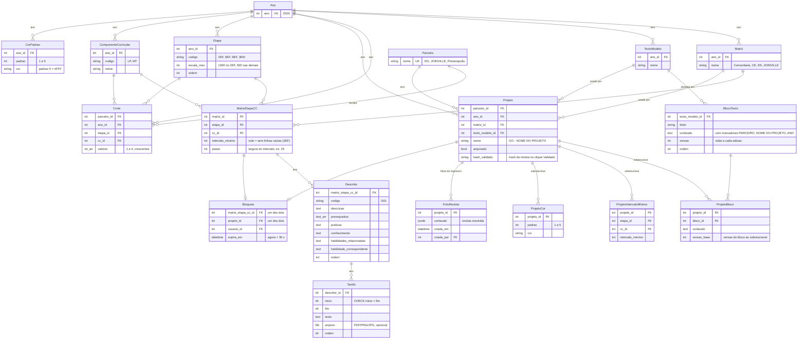

# Modelo ER — rascunho (Django + PostgreSQL)

Fonte: decisões D-046 a D-083 do `state.md`. Rascunho para a sessão de modelagem; nada aqui está implementado.

## Restrições que o diagrama não mostra

| Tabela | Restrição | Decisão |
|---|---|---|
| Etapa / ComponenteCurricular | UNIQUE (ano, codigo) | D-086 |
| CorPadrao | UNIQUE (ano, padrao) | D-086 |
| Matriz | UNIQUE (ano, nome) | D-057 |
| MatrizEtapaCC | UNIQUE (matriz, etapa, cc) | D-053 |
| Descritor | UNIQUE (matriz_etapa_cc, codigo) | — |
| Corte | UNIQUE (parceiro, ano, etapa, cc); CHECK 1 ≤ cardinalidade(valores) ≤ 4 | D-050, D-055 |
| Corte | crescente e dentro de 0..escala_max: validado no `clean()` (CHECK não lê outra tabela) | D-055 |
| Projeto | UNIQUE (parceiro, ano) WHERE NOT arquivado | D-047, D-068 |
| ProjetoBloco | UNIQUE (projeto, bloco); bloco precisa ser do texto_modelo do projeto (`clean()`) | D-062 |
| ProjetoIntervaloMinimo / ProjetoCor | UNIQUE (projeto, etapa, cc) / (projeto, padrao) | D-053, D-060 |
| Bloqueio | CHECK exatamente um alvo; UNIQUE parcial em cada alvo | D-081 |
| Histórico | `django-simple-history` em todos os modelos editáveis | D-082 |

## O que não vira tabela

- **Grupo de corte:** calculado na exportação (ordenar listas distintas de `valores` por aba e numerar). D-049, D-056.
- **Etapas avaliadas pelo parceiro:** existem `Corte` para parceiro × ano × etapa × CC. D-049.
- **Padrão de cada tarefa:** calculado na renderização com os cortes do parceiro; cruzou corte → padrão da âncora maior. D-058.
- **Perfis:** `Group` do Django (Admin, Pedagógica, Impresso, Mídias Digitais). D-073, D-083.
- **"Validado" e "mudou para o impresso":** comparação da revista resolvida atual com `hash_validado` e com a última `FotoRevista`. Qualquer caminho (matriz, texto, corte, cor, nome) invalida sozinho, sem sinalização por tabela. D-074, D-077, D-078.

## Decidido depois do rascunho

1. Ao abrir um ano novo, os projetos **não** são clonados: renascem pela cascata dos cortes com "PARCEIRO - NOME DO PROJETO". D-085.
2. `Etapa`, `ComponenteCurricular` e `CorPadrao` são **por ano** (clonados com o ano). D-086.
3. `ProjetoBloco` desatualizado (`versao_base` < `versao` do bloco) **não** bloqueia o "Validado": só avisa e fica marcado. D-087.
