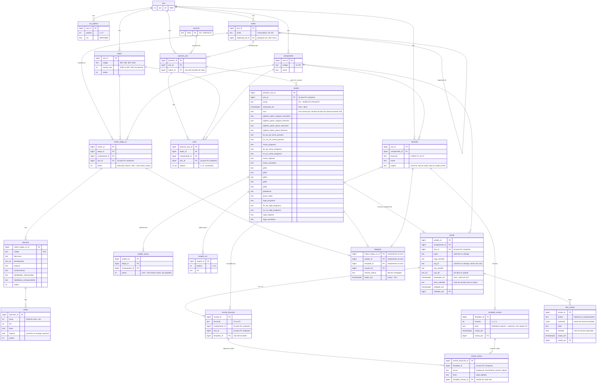

# Modelo ER — rascunho (Django + PostgreSQL 17)

Fonte: decisões D-046 a D-125 do `state.md`. Reescrito em 2026-10-29 com a skill `postgres-best-practices`, para incluir revista por componente, fascículos, templates, cópia por seção e variáveis. Nada aqui está implementado.

Convenções aplicadas em todas as tabelas:
- **Chave:** `id bigint` identity (`BigAutoField`). Sem `serial` e sem UUID: o volume é pequeno e nada é distribuído.
- **Nomes:** `snake_case`.
- **Texto:** `text` com `CHECK (length(...) <= n)`, sem `varchar(n)`.
- **Datas:** `timestamptz` com `USE_TZ = True`.
- **Hash:** `text CHECK (hash ~ '^[0-9a-f]{64}$')`.

## Restrições que o diagrama não mostra

| Tabela | Restrição | Decisão |
|---|---|---|
| etapa / componente | UNIQUE (ano_id, codigo); UNIQUE (id, ano_id) para receber FK composta | D-086, D-090 |
| cor_padrao | UNIQUE (ano_id, padrao); CHECK padrao BETWEEN 1 AND 5; CHECK cor ~ '^#[0-9A-Fa-f]{6}$' | D-064, D-086 |
| matriz | UNIQUE (ano_id, nome); UNIQUE (id, ano_id); CHECK duplicada_de_id <> id; duplicada_de ON DELETE SET NULL | D-057, D-113, D-124 |
| parceiro_ano | UNIQUE (parceiro_id, ano_id); UNIQUE (id, ano_id); FK (matriz_id, ano_id) composta | D-088, D-090 |
| matriz_etapa_cc | UNIQUE (matriz_id, etapa_id, componente_id); FKs (matriz, ano), (etapa, ano), (componente, ano) compostas | D-053, D-090 |
| descritor | UNIQUE (matriz_etapa_cc_id, codigo) | — |
| corte | UNIQUE (parceiro_ano_id, etapa_id, componente_id); CHECK cardinality(valores) BETWEEN 1 AND 4 AND array_position(valores, NULL) IS NULL; FKs (parceiro_ano, ano), (etapa, ano), (componente, ano) compostas | D-050, D-055, D-090 |
| corte | crescente e dentro de 0..escala_max: `clean()` (CHECK não lê outra tabela) | D-055 |
| template | UNIQUE (ano_id, componente_id, fasciculo, nome); UNIQUE (id, ano_id, componente_id, fasciculo); CHECK fasciculo IN ('F1','F2'); FK (componente, ano) composta | D-098, D-122 |
| template_versao | UNIQUE (template_id, numero); UNIQUE (id, template_id); só INSERT (a versão atual é a de maior número) | D-115, D-125 |
| projeto | UNIQUE (parceiro_ano_id) WHERE arquivado_em IS NULL; UNIQUE (id, ano_id); FK (parceiro_ano, ano) composta; variáveis: CHECK length <= 200 | D-047, D-068, D-100 |
| projeto_passo / projeto_cor | UNIQUE (projeto, etapa, componente) / (projeto, padrao); FKs compostas de ano | D-091, D-060 |
| revista | UNIQUE (projeto_id, componente_id); UNIQUE (id, ano_id, componente_id); FKs (projeto, ano), (componente, ano) compostas; CHECK (svg_f2 IS NULL) = (svg_sha256 IS NULL); idem capa | D-095, D-117, D-118 |
| revista_fasciculo | UNIQUE (revista_id, fasciculo); UNIQUE (id, template_id); FK (revista_id, ano_id, componente_id) composta; FK (template_id, ano_id, componente_id, fasciculo) → template (MATCH SIMPLE: nulo = sem template) | D-098, D-106, D-124 |
| revista_secao | UNIQUE (revista_fasciculo_id, secao); FK (revista_fasciculo_id, template_id) → revista_fasciculo (id, template_id); FK (template_versao_id, template_id) → template_versao (id, template_id) | D-104, D-115 |
| foto_revista | CHECK motivo IN ('impresso','arquivamento'); índice (revista_id, motivo, criada_em DESC) | D-077, D-097 |
| bloqueio | CHECK num_nonnulls(matriz_etapa_cc_id, projeto_id, template_id) = 1; UNIQUE parcial em cada alvo | D-081, D-109 |
| histórico | `django-simple-history` nos modelos editados à mão, **exceto** bloqueio e template_versao (já é histórico) | D-082, D-125 |

**Por que a FK composta de revista_secao resolve a troca de template:** a cópia carrega o `template_id`. Trocar o template de um revista_fasciculo com cópias é recusado pelo banco (NO ACTION) até o serviço apagar as cópias, e esse é exatamente o passo que pede "confirmação forte" (D-104). A cópia também não consegue apontar para a versão de outro template.

**FKs compostas:** o ORM não as declara; elas entram por `migrations.RunSQL` com `reverse_sql`, nome `fk_<tabela>_<alvo>_ano`, e um teste confere a lista em `pg_constraint` (D-124). Em migrações futuras sobre tabelas com dados, use `ADD CONSTRAINT … NOT VALID` seguido de `VALIDATE CONSTRAINT`.

**ON DELETE:**
- `PROTECT` em ano, parceiro, matriz, template, template_versao e componente, para que nada de anos anteriores seja apagado em cascata.
- `CASCADE` só onde há composição real: matriz_etapa_cc → descritor → tarefa (reimportação, D-094) e revista → revista_fasciculo → revista_secao.
- O Django emula `on_delete` em Python; no banco, a FK fica NO ACTION.

**Índices:** o Django cria índice em cada FK simples. As FKs compostas começam pela mesma coluna, então esse índice basta para o volume (cerca de 100 revistas por ano). Não há índice extra até o EXPLAIN pedir.

## Regras da aplicação (não cabem em restrição)

- **Variáveis:** cada uma é uma coluna de `projeto`, porque a lista é fixa no código (D-100). Assim a planilha da aba Variáveis é o `list_editable` do admin (D-107, D-121). Uma variável nova vira `ADD COLUMN` anulável, que é instantâneo. Parceiro, nome do projeto e ano são automáticas e não são gravadas.
- **Texto efetivo de uma seção:** `revista_secao.texto` se houver cópia; senão, a seção da última `template_versao` do template escolhido.
- **Template mudou numa seção com cópia:** a cópia aponta para uma versão menor que a atual e o texto daquela seção mudou. Aparece um aviso e a tela "seu texto | template novo com diff", com edição à mão ou "descartar cópia". Não bloqueia o "Validado" (D-087, D-115).
- **Hash:** calculado em Python sobre JSON canônico (`json.dumps(..., sort_keys=True, separators=(",", ":"), ensure_ascii=False)`), nunca sobre o `jsonb` guardado, que reordena chaves.
  - O hash do "Validado" cobre a revista resolvida mais `svg_sha256` e `capa_sha256` (D-118).
  - A foto do impresso guarda só os textos (D-112).
  - Mudar uma variável derruba só a revista cujo texto a usa (D-125).
- **Clique com versão:** "Validado" e "Revista Impressa Atualizada" enviam o hash visto, e o servidor recusa se o atual for outro (D-089). Em lote, vale a mesma regra por revista: o lote envia pares (revista, hash) (D-120).
- **"Validado" é recusado se:**
  - parceiro_ano não tiver matriz;
  - algum corte não tiver matriz_etapa_cc na matriz escolhida;
  - faltar template no F1 ou no F2;
  - faltar SVG ou capa;
  - o SVG não tiver um id exigido pelas seções efetivas do F2;
  - alguma variável usada estiver vazia;
  - o nome ainda terminar em " - NOME DO PROJETO".

  As mesmas condições alimentam o Painel da temporada (D-093, D-106, D-112, D-120).
- **Preview:** abre sempre; texto sem template ou variável vazia aparece como faixa vermelha (D-116).
- **Cascata num ponto só:** gravar cortes cria ou reativa revistas e projetos, ou arquiva os que ficaram sem cortes, num único serviço. A transação começa com `SELECT … FOR UPDATE` na linha de parceiro_ano (D-093, D-117).
- **Arquivar a revista congela:** grava `foto_revista(motivo='arquivamento')` e a revista arquivada mostra essa foto. Quando os cortes voltam, a mesma linha é reativada. O projeto é arquivado quando todas as revistas dele estiverem arquivadas (D-117).
- **Projeto readicionado (D-068):** as revistas novas herdam a última foto do impresso da revista arquivada do mesmo parceiro_ano e componente, copiada com `herdada = true` (D-094).
- **Foto:** montar a revista, comparar o hash e gravar acontecem numa transação REPEATABLE READ (D-125).
- **Bloqueio:** aquisição com `INSERT … ON CONFLICT (alvo) WHERE … DO UPDATE … WHERE bloqueio.expira_em < now() OR bloqueio.sessao_edicao = EXCLUDED.sessao_edicao RETURNING id`; se não voltar nenhuma linha, o alvo está ocupado. O relógio é sempre o `now()` do banco. Toda rota de escrita confere o bloqueio na mesma transação. Ações em lote pulam alvos travados e listam os pulados (D-081, D-121).
- **Template salvo:** cada salvamento insere uma template_versao; não há UPDATE de texto. Antes de salvar, a tela lista as revistas afetadas e os SVGs que ficariam sem algum id exigido (D-099, D-125).
- **Upload de SVG:**
  - leitura com `defusedxml`, só uma lista fixa de tags e atributos (sem `on*`, `script`, `foreignObject` nem `href` externo), até 3 MB;
  - ids e classes recebem um prefixo;
  - o arquivo é gravado com nome uuid e nunca é sobrescrito;
  - `svg_ids` guarda os ids lidos.

  Fonte: D-108 e D-125.
- **Abrir ano:** comando `manage.py abrir_ano N` numa única transação, começando pelo `INSERT` em ano, de modo que o UNIQUE barra o segundo clique. Copia só cadastros (etapa, componente, cor_padrao, matriz com matriz_etapa_cc, descritor e tarefa, template com a última versão) usando um mapa de ids antigo→novo. Cortes, parceiro_ano, projetos e escolhas **não** passam, e `duplicada_de` aponta para a origem no ano anterior (D-119, D-124).
- **Seed dos templates:** comando `carregar_templates --ano 2026` lê os `.hbs` do repositório, cria o template (`origem` = nome do arquivo) com a versão 1 e nunca sobrescreve. Daí em diante, a fonte é o banco (D-098).

## O que não vira tabela

- **Fascículo:** coluna com CHECK ('F1', 'F2'). D-122.
- **Lista de variáveis:** constante no código e uma coluna por variável em `projeto`. D-100.
- **Seções do template:** cabeçalhos `## id` dentro do texto da versão, conferidos ao salvar (F1: `introducao`, `fechamento`; F2: `## passoN` e `## dlg-*`). D-111, D-114.
- **Grupo de corte:** calculado na exportação. D-049, D-056.
- **Etapas avaliadas:** existem cortes para parceiro_ano × etapa × componente. D-049.
- **Padrão de cada tarefa:** calculado na renderização (âncora maior). D-058.
- **Perfis:** `Group` do Django (Admin, Pedagógica, Impresso, Mídias Digitais). D-073, D-083.

## Removido desde o rascunho de 2026-10-27

- `texto_modelo`, `bloco_texto`, `projeto_bloco` e `parceiro_ano.texto_modelo_id`. O texto agora é template + cópia por seção (D-098, D-115, D-125).
- `projeto.hash_validado` e `foto_revista.projeto_id`, que passaram para a revista (D-097).
- O clone de parceiro_ano e da escolha de matriz no ano novo (D-106, D-119).
