# Modelo ER — rascunho (Django + PostgreSQL)

Fonte: decisões D-046 a D-094 do `state.md`. Rascunho para a sessão de modelagem; nada aqui está implementado. Revisado em 2026-10-27 (D-088 a D-094).

```mermaid
erDiagram
    Ano ||--o{ Etapa : tem
    Ano ||--o{ ComponenteCurricular : tem
    Ano ||--o{ CorPadrao : tem
    Ano ||--o{ Matriz : tem
    Ano ||--o{ TextoModelo : tem
    Ano ||--o{ ParceiroAno : tem

    Parceiro ||--o{ ParceiroAno : "participa em"
    Matriz |o--o{ ParceiroAno : "escolhida por"
    TextoModelo |o--o{ ParceiroAno : "escolhido por"

    ParceiroAno ||--o{ Corte : tem
    Etapa ||--o{ Corte : ""
    ComponenteCurricular ||--o{ Corte : ""

    Matriz ||--o{ MatrizEtapaCC : "dividida em"
    Etapa ||--o{ MatrizEtapaCC : ""
    ComponenteCurricular ||--o{ MatrizEtapaCC : ""
    MatrizEtapaCC ||--o{ Descritor : tem
    Descritor ||--o{ Tarefa : tem

    TextoModelo ||--o{ BlocoTexto : "dividido em"

    ParceiroAno ||--o{ Projeto : "gera em cascata"
    Projeto ||--o{ ProjetoBloco : sobrescreve
    BlocoTexto ||--o{ ProjetoBloco : ""
    Projeto ||--o{ ProjetoPasso : sobrescreve
    Projeto ||--o{ ProjetoCor : sobrescreve
    Projeto ||--o{ FotoRevista : fotos

    MatrizEtapaCC ||--o| Bloqueio : ""
    Projeto ||--o| Bloqueio : ""

    Ano {
        int ano UK "2026"
    }
    Parceiro {
        string nome UK "GO, JOINVILLE, Florianopolis"
    }
    ParceiroAno {
        int parceiro_id FK
        int ano_id FK
        int matriz_id FK "nulo ate escolher"
        int texto_modelo_id FK "nulo ate escolher"
    }
    Etapa {
        int ano_id FK
        string codigo "2EF, 5EF, 9EF, 3EM"
        int escala_max "1000 no 2EF, 500 nas demais"
        int ordem
    }
    ComponenteCurricular {
        int ano_id FK
        string codigo "LP, MT"
        string nome
    }
    Matriz {
        int ano_id FK
        string nome "Comunitaria, CE, ES, JOINVILLE"
    }
    MatrizEtapaCC {
        int matriz_id FK
        int etapa_id FK
        int cc_id FK
        int ano_id FK "so para as FKs compostas"
        int passo "Intervalo minimo na UI; nulo = sem linhas vazias"
    }
    Descritor {
        int matriz_etapa_cc_id FK
        string codigo "D01"
        text descricao
        text_arr prerequisitos
        text praticas
        text conhecimento
        text habilidades_relacionadas
        text habilidade_correspondente
        int ordem
    }
    Tarefa {
        int descritor_id FK
        int inicio "CHECK inicio < fim"
        int fim
        text texto
        file arquivo "PDF/PNG/JPG, opcional"
        int ordem
    }
    TextoModelo {
        int ano_id FK
        string nome
    }
    BlocoTexto {
        int texto_modelo_id FK
        string titulo
        string tipo "texto, paragrafos ou imagem"
        text texto "com marcadores"
        text_arr paragrafos "com marcadores"
        file imagem
        int versao "sobe a cada edicao"
        int ordem
    }
    Corte {
        int parceiro_ano_id FK
        int etapa_id FK
        int cc_id FK
        int ano_id FK "so para as FKs compostas"
        int_arr valores "1 a 4, crescentes"
    }
    Projeto {
        int parceiro_ano_id FK
        string nome "GO - NOME DO PROJETO"
        bool arquivado
        string hash_validado "hash da versao vista no clique"
    }
    ProjetoBloco {
        int projeto_id FK
        int bloco_id FK
        text texto
        text_arr paragrafos
        file imagem
        int versao_base "versao do bloco ao sobrescrever"
    }
    ProjetoPasso {
        int projeto_id FK
        int etapa_id FK
        int cc_id FK
        int passo "nulo = sem linhas vazias, de proposito"
    }
    CorPadrao {
        int ano_id FK
        int padrao "1 a 5"
        string cor "padrao 5 = #FFF"
    }
    ProjetoCor {
        int projeto_id FK
        int padrao "1 a 5"
        string cor
    }
    FotoRevista {
        int projeto_id FK
        string motivo "impresso ou arquivamento"
        jsonb conteudo "revista resolvida"
        string hash
        datetime criada_em
        int criada_por FK
    }
    Bloqueio {
        int matriz_etapa_cc_id FK "um dos dois"
        int projeto_id FK "um dos dois"
        int usuario_id FK
        string sessao_edicao "aba do editor"
        datetime expira_em "agora + 30 s"
    }
```

## Restrições que o diagrama não mostra

| Tabela | Restrição | Decisão |
|---|---|---|
| Etapa / ComponenteCurricular | UNIQUE (ano, codigo); UNIQUE (id, ano) para receber FK composta | D-086, D-090 |
| Matriz / TextoModelo | UNIQUE (ano, nome); UNIQUE (id, ano) | D-057, D-090 |
| CorPadrao | UNIQUE (ano, padrao) | D-086 |
| ParceiroAno | UNIQUE (parceiro, ano); UNIQUE (id, ano); FK (matriz, ano) e (texto_modelo, ano) compostas | D-088, D-090 |
| MatrizEtapaCC | UNIQUE (matriz, etapa, cc); FK (matriz, ano), (etapa, ano), (cc, ano) compostas | D-053, D-090 |
| Descritor | UNIQUE (matriz_etapa_cc, codigo) | — |
| Corte | UNIQUE (parceiro_ano, etapa, cc); CHECK 1 ≤ cardinalidade(valores) ≤ 4; FK (parceiro_ano, ano), (etapa, ano), (cc, ano) compostas | D-050, D-055, D-090 |
| Corte | crescente e dentro de 0..escala_max: validado no `clean()` (CHECK não lê outra tabela) | D-055 |
| Projeto | UNIQUE (parceiro_ano) WHERE NOT arquivado | D-047, D-068 |
| BlocoTexto / ProjetoBloco | CHECK: só a coluna do `tipo` preenchida (texto, paragrafos ou imagem) | D-092 |
| ProjetoBloco | UNIQUE (projeto, bloco); bloco do texto-modelo do parceiro_ano (`clean()` + fluxo de troca); `bloco` com PROTECT | D-062, D-093 |
| ProjetoPasso / ProjetoCor | UNIQUE (projeto, etapa, cc) / (projeto, padrao); etapa e cc do ano do projeto (`clean()`) | D-091, D-060 |
| Bloqueio | CHECK exatamente um alvo; UNIQUE parcial em cada alvo | D-081 |
| Histórico | `django-simple-history` em todos os modelos editáveis, **exceto** Bloqueio | D-082, D-093 |

FK composta: o ORM não declara; entra por `migrations.RunSQL` (testado em PostgreSQL 17).

## Regras da aplicação (não cabem em restrição)

- **Clique com versão:** "Validado" e "Revista Impressa Atualizada" enviam o hash da revista que estava na tela. O servidor monta a revista atual, compara e recusa se for outra. D-089.
- **"Validado" é recusado** se: `ParceiroAno` sem matriz ou sem texto-modelo; algum `Corte` do parceiro sem `MatrizEtapaCC` correspondente na matriz escolhida; nome do projeto ainda terminando em " - NOME DO PROJETO". D-088, D-093.
- **Cascata num único ponto:** criar e arquivar projetos ao gravar cortes acontece num só serviço, em transação. D-093.
- **Arquivar congela:** ao arquivar, grava `FotoRevista(motivo=arquivamento)`; o projeto arquivado mostra essa foto e não é mais montado com os cortes vivos. D-093.
- **Projeto readicionado herda a última foto do impresso** do projeto arquivado, para o diff do impresso partir do que já foi impresso. D-094.
- **Trocar o texto-modelo** de um ParceiroAno lista as sobrescritas de bloco que serão descartadas e pede confirmação. **Remover um bloco** com sobrescritas é recusado (PROTECT) e a tela lista os projetos. D-093.
- **Bloqueio:** pertence a usuário + aba (`sessao_edicao`); a aquisição sobrescreve a linha expirada; toda rota de escrita confere o bloqueio. D-081, D-093.

## O que não vira tabela

- **Grupo de corte:** calculado na exportação (ordenar listas distintas de `valores` por aba e numerar). D-049, D-056.
- **Etapas avaliadas pelo parceiro:** existem `Corte` para o parceiro_ano × etapa × CC. D-049.
- **Padrão de cada tarefa:** calculado na renderização com os cortes do parceiro; cruzou corte → padrão da âncora maior. D-058.
- **Perfis:** `Group` do Django (Admin, Pedagógica, Impresso, Mídias Digitais). D-073, D-083.
- **"Validado" e "mudou para o impresso":** revista resolvida atual comparada com `hash_validado` e com a última `FotoRevista(motivo=impresso)`. Desfazer uma mudança faz o "Validado" voltar (aceito, D-094).

## Decidido depois do rascunho

1. Ao abrir um ano novo, os projetos **não** são clonados: renascem pela cascata dos cortes com "PARCEIRO - NOME DO PROJETO". `ParceiroAno` **é** clonado, levando a escolha de matriz e texto-modelo. D-085, D-088.
2. `Etapa`, `ComponenteCurricular` e `CorPadrao` são **por ano** (clonados com o ano). D-086.
3. `ProjetoBloco` desatualizado (`versao_base` < `versao` do bloco) **não** bloqueia o "Validado": só avisa e fica marcado. O texto da versão base sai do histórico do bloco. D-087.
4. Reimportar a matriz recria descritores e tarefas com ids novos; a auditoria por registro se perde e isso é aceito. D-094.
