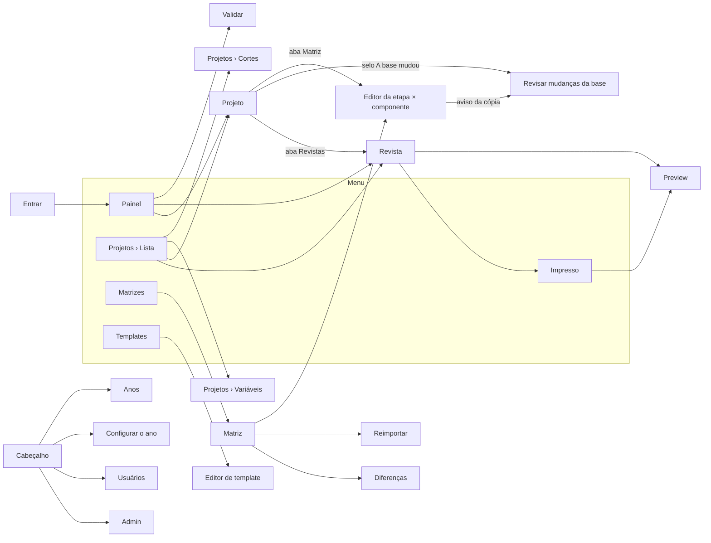

# Mapa de páginas e caminhos de navegação

Inventário de todas as páginas das telas B em 25/11/2026 e do caminho de cliques até cada uma, para comparar com o
redesenho do Figma na etapa 11 (K-048, D-277). Rotas e nomes em [`telas-b.md`](telas-b.md); regras de cada tela nas
[`fichas/`](fichas/).

Fontes: `app/nucleo/urls/` (rotas), `templates/ui/base.html` (menu), `templates/ui/_componentes/anos.html` (seletor
de ano), os `` de cada template, `urls/painel.py::link` (links "falta") e `urls/ui_revista.py::_situacao`.
Fica de fora o que não é página: parciais HTMX, POSTs de campo (autosave), bloqueio e downloads de arquivo de item.

## 1. Cabeçalho comum (toda página logada)

| Elemento | Destino | Quem vê |
|---|---|---|
| Marca "Revista Eletrônica" | `/` → Painel do maior ano (sem ano: Anos) | todos |
| Menu **Painel** | `/painel/<ano>/` | todos |
| Menu **Projetos** | `/ui/projeto/ano/<ano>/` | todos |
| Menu **Matrizes** | `/ui/matriz/<ano>/` | todos |
| Menu **Templates** | `/ui/templates/<ano>/` | todos |
| Menu **Impresso** | `/ui/impresso/<ano>/` | permissão `marcar_impressa` |
| Seletor de ano: troca de ano | mesma página no outro ano | todos |
| Seletor de ano: "Configurar <ano>" | `/ui/anos/<ano>/` | `view_ano` |
| Seletor de ano: "Abrir novo ano" | `/ui/anos/` | `abrir_ano` |
| "Admin" | `/admin/` | superusuário |
| "Usuários" | `/ui/usuarios/` | `auth.change_user` |
| "Sair" | `/conta/sair/` → login | todos |

## 2. Páginas e caminho até cada uma

Caminho = cliques a partir do login. "→" é um clique.

### Conta

| Página | URL | Caminho | Etapa 11 |
|---|---|---|---|
| Entrar | `/conta/entrar/` | qualquer URL sem login | — |
| Criar senha pelo link | `/conta/senha/<uid>/<token>/` | link gerado em Usuários → "Link de acesso" | — |
| Senha pronta | `/conta/senha/pronto/` | depois de criar a senha | — |

### Painel

| Página | URL | Caminho | Etapa 11 |
|---|---|---|---|
| Painel da temporada | `/painel/<ano>/` | login (cai aqui) | filtros, contadores, links "falta", preview; o Figma não tem Painel no menu |
| Validar revistas | `/ui/validar/<ano>/?revista=…` | Painel → marcar revistas → "Validar" | — |
| Validar em lote (estilo admin) | `/painel/<ano>/validar/` | só pelo admin | fora do redesenho |

Links "falta" do Painel levam a: Matriz (`/ui/matriz/m/<pk>/`), Projeto (aba Matriz ou Dados), Projetos › Cortes,
Impresso (`?revista=<pk>`) e Revista (`#infograficos` ou topo).

### Projetos

| Página | URL | Caminho | Etapa 11 |
|---|---|---|---|
| Projetos › Lista | `/ui/projeto/ano/<ano>/` | menu Projetos | barra em massa: "Atribuir matriz…" (D-277 tira), "Atribuir template…", zip, preview |
| Projetos › Cortes | `/ui/projeto/ano/<ano>/cortes/` | Projetos → aba Cortes | "Novo parceiro" (D-277 tira), "Exportar planilha", renomear parceiro, excluir/desativar |
| Projetos › Variáveis | `/ui/projeto/ano/<ano>/variaveis/` | Projetos → aba Variáveis | "Copiar linha" |
| Projeto (abas Dados, Matriz, Cortes, Passos e cores, Revistas) | `/ui/projeto/<pk>/?aba=…` | Projetos → nome do projeto · Painel → projeto · Revista → "Projeto" · Variáveis → projeto | — |
| Editar só neste projeto / Apontar etapa (POST) | `/ui/projeto/<pk>/etapa/apontar/` | Projeto → aba Matriz → botão da etapa | abre direto o editor da cópia |
| Desfazer cópia ou apontamento | `/ui/projeto/<pk>/etapa/<mec>/desfazer/` | Projeto → aba Matriz → "Desfazer" | confirmação forte |
| Revisar mudanças da base | `/ui/revisao/<pk>/` | Projeto → aba Matriz → selo "A base mudou" · editor da cópia → aviso | — |
| Revista (ficha) | `/ui/revista/<ano>/<pk>/` | Projetos › Lista → revista · Painel → revista · Projeto → aba Revistas | passos: Matriz e cortes, Template F1, Template F2, Infográficos, Capa, Dados do projeto (âncoras `#templates`, `#infograficos`, `#arquivos`) |
| Zip da revista (download) | `/ui/revista/<ano>/<pk>/zip/` | Projetos › Lista ou ficha → "Zip" | — |
| Preview (sumário, F1, F2) | `/preview/<id>/`, `/preview/<id>/f1/`, `/preview/<id>/f2/<tipo>/` | "Preview" em Lista, Painel, Projeto, Revista ou Impresso | fora do redesenho (é a revista) |

### Matrizes (no Figma: "Modelos")

| Página | URL | Caminho | Etapa 11 |
|---|---|---|---|
| Matrizes do ano | `/ui/matriz/<ano>/` | menu Matrizes | "Nova matriz" (D-277 tira) |
| Nova matriz | `/ui/matriz/<ano>/nova/` | Matrizes → "Nova matriz" | sai da UI (D-277) |
| Matriz (etapas × componentes) | `/ui/matriz/m/<pk>/` | Matrizes → nome da matriz | Renomear, Duplicar, Reimportar, Diferenças, Excluir |
| Reimportar matriz | `/ui/matriz/m/<pk>/reimportar/` | Matrizes → matriz → "Reimportar" | — |
| Diferenças da reimportação | `/ui/matriz/m/<pk>/diferencas/` | Matrizes → matriz → "Diferenças" | — |
| Editor da etapa × componente | `/ui/matriz/mec/<pk>/` (com `/d/<dpk>/`: descritor aberto) | Matrizes → matriz → etapa · Projeto → aba Matriz → "Editar" (cópia) | aviso de cópias em projetos (D-294) |

### Templates (no Figma: "Modelos")

| Página | URL | Caminho | Etapa 11 |
|---|---|---|---|
| Templates do ano | `/ui/templates/<ano>/` | menu Templates | "Novo template" (D-277 tira) |
| Novo template | `/ui/templates/<ano>/novo/` | Templates → "Novo" | sai da UI (D-277) |
| Editor de template (seções + prévia ao vivo) | `/ui/templates/editar/<pk>/` | Templates → nome do template | — |

### Impresso

| Página | URL | Caminho | Etapa 11 |
|---|---|---|---|
| Impresso | `/ui/impresso/<ano>/` (`?revista=<pk>` abre o detalhe) | menu Impresso · Revista → situação | "Marcar atualizada", planilhas F1/F2 (`/impresso/<pk>/planilhas/`), preview |

### Ano (pelo seletor do cabeçalho)

| Página | URL | Caminho | Etapa 11 |
|---|---|---|---|
| Anos / Abrir novo ano | `/ui/anos/` | seletor de ano → "Abrir novo ano" | — |
| Configurar o ano (etapas, componentes, padrões) | `/ui/anos/<ano>/` | seletor de ano → "Configurar <ano>" | padrões em `#padroes` |

### Transversais

| Página | URL | Caminho | Etapa 11 |
|---|---|---|---|
| Excluir (qualquer entidade) | `/ui/excluir/<modelo>/<pk>/` | "Excluir" em Anos, Cortes, Matriz ou Templates | — |
| Usuários | `/ui/usuarios/` | cabeçalho → "Usuários" | — |
| Novo usuário | `/ui/usuarios/novo/` | Usuários → "Novo" | — |
| Link de acesso | `/ui/usuarios/<pk>/link/` | Usuários → "Link de acesso" na linha | — |
| Admin do Django | `/admin/` | cabeçalho → "Admin" | fora do redesenho |

## 3. Redirecionamentos antigos (302, não são páginas)

`/cortes/<ano>/`, `/ui/variaveis/<ano>/`, `/ui/revista/<ano>/`, `/ui/lotes/<ano>/matriz/` e `/ui/lotes/<ano>/template/`
levam à aba equivalente de Projetos.

## 4. Diagrama de navegação

## 5. Para a etapa 11 (conferir contra o Figma)

- Saem da UI pela D-277: Nova matriz, Novo template, Novo parceiro e "Atribuir matriz…" em massa.
- Em aberto: "Duplicar matriz" conta como criação e sai também?
- Matrizes e Templates viram o item "Modelos" do menu novo.
- O menu do Figma não tem Painel: falta decidir para onde vai o Painel (e o "Validar" que sai dele).
